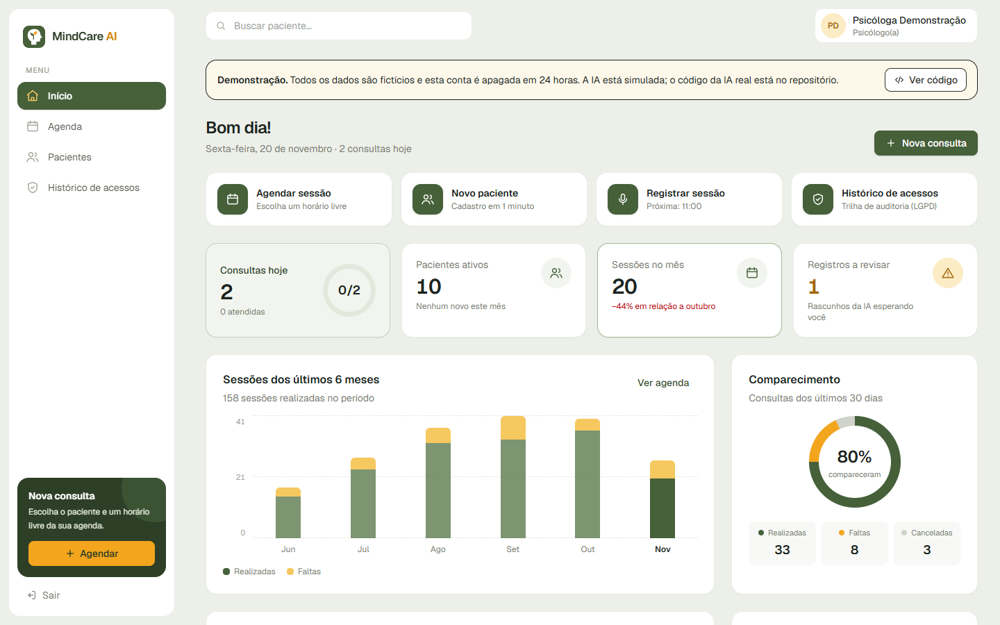
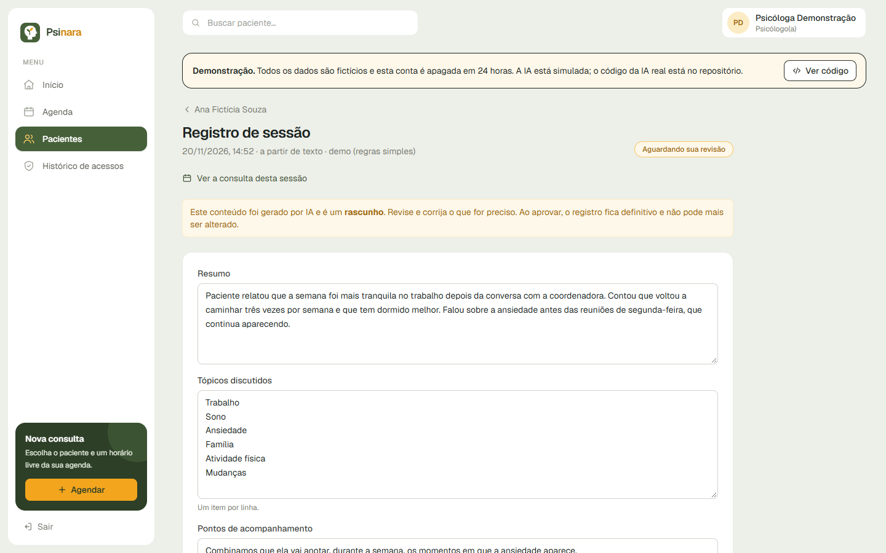
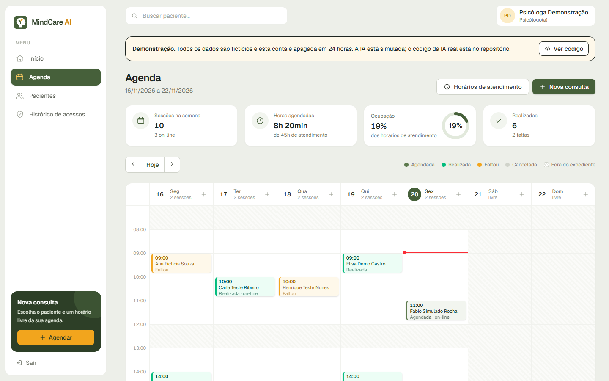
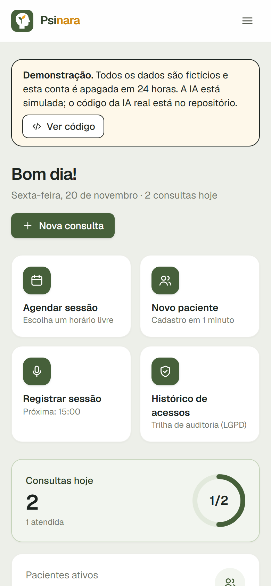

# MindCare AI — demonstração

Gestão de consultório para psicólogos, com **registros de sessão organizados por IA e sempre revisados pelo profissional**.
Esta é a versão de portfólio de um produto em desenvolvimento: um recorte do sistema real, com dados fictícios.

**[Experimentar a demonstração](https://mindcare-ai-portfolio.vercel.app)** · sem cadastro: cada visitante ganha uma conta própria, com pacientes e sessões fictícias, apagada em 24 horas.



## O que dá para fazer

- **Painel do dia**: consultas de hoje, sessões dos últimos 6 meses, comparecimento, movimento por dia da semana e pacientes sem sessão há 30 dias. Os gráficos são SVG/CSS próprios, sem biblioteca.
- **Agenda semanal** em grade de horários, com horários de atendimento, horários livres e checagem de conflito.
- **Pacientes**: ficha com frequência, próxima sessão, histórico de consultas e **exportação de todos os dados em JSON**, para pedidos de acesso e portabilidade (LGPD, art. 18).
- **Registro de sessão com IA**: o profissional grava o áudio ou digita, e a IA devolve um **rascunho** com resumo, tópicos, pontos de acompanhamento e trechos para conferir. O profissional edita e aprova; depois de aprovado, o registro não muda mais.
- **Histórico de acessos**: trilha de auditoria de quem abriu ou alterou o quê.

| Revisão do rascunho da IA | Agenda | Celular |
|---|---|---|
|  |  |  |

## Decisões que valem destacar

**IA responsável**
- A IA **não diagnostica, não sugere tratamento e não decide**. Ela só organiza o que está no texto, e tudo passa pela revisão do psicólogo ([prompt e regras](backend/app/ai/summarizer.py)).
- A IA só funciona com o **consentimento do paciente** registrado. Sem ele, o sistema bloqueia (o paciente "Diego" da demonstração mostra isso).
- Na versão completa, a IA roda **no próprio servidor**: Whisper (`faster-whisper`) para transcrever e um modelo aberto via Ollama para resumir. Nenhum dado clínico vai para empresas de IA, e o áudio é apagado logo depois da transcrição.
- Na demonstração pública, a IA é **simulada** com regras simples ([`app/ai/demo.py`](backend/app/ai/demo.py)), porque manter os modelos exigiria um servidor de ~8 GB ligado o tempo todo. O fluxo é o mesmo: rascunho, revisão e aprovação.

**Segurança e LGPD**
- Transcrições e resumos **criptografados no banco** (Fernet), com chave fora do código.
- Senhas com **Argon2**. JWT de curta duração, e refresh token de **uso único com detecção de reuso**: um token roubado e reutilizado encerra todas as sessões.
- **Isolamento por profissional** em toda consulta ao banco: um paciente de outro usuário é tratado como inexistente (404), e a tentativa fica registrada.
- **Trilha de auditoria** só com IDs, nunca dados pessoais. No PostgreSQL, um gatilho torna a tabela somente-inserção.
- No PostgreSQL/Supabase, as tabelas também ficam fechadas para a API pública (RLS sem políticas e acesso revogado).
- Limite de tentativas por IP (login, demonstração), CSP e cabeçalhos de segurança no frontend, redirecionamento pós-login validado.
- O navegador **nunca fala com a API**: só o servidor Next.js, que guarda os tokens em cookies httpOnly. Na hospedagem, a API exige uma chave interna que só o frontend conhece.

**Demonstração isolada**
- Cada clique em "Experimentar" cria uma **conta temporária com dados fictícios**, então um visitante nunca vê o que outro escreveu.
- Contas vencidas são apagadas por inteiro, há um teto de contas simultâneas, e cadastro e recuperação de senha ficam fechados.

## Stack

| Camada | Tecnologias |
|---|---|
| Frontend | Next.js 16 (App Router, Server Actions, Cache Components), React 19, TypeScript, Tailwind CSS 4 |
| Backend | Python 3.12, FastAPI, SQLAlchemy 2, Alembic, Pydantic 2, slowapi |
| Banco | PostgreSQL (Supabase) em produção; SQLite para rodar localmente e na demonstração |
| IA | faster-whisper (transcrição) e Ollama + Qwen2 (resumo), locais; ou simulada |
| Testes | pytest (180 testes no backend) e Playwright (fluxos no navegador) |
| Infra | Docker; demonstração na Vercel (frontend) e no Render (API) |

## Rodar localmente

Requisitos: Python 3.12 e Node.js 20+.

```bash
# API
cd backend
python -m venv .venv && source .venv/bin/activate   # Windows: .venv\Scripts\activate
pip install -r requirements.txt
cp .env.example .env    # gere as chaves com os comandos indicados no arquivo
alembic upgrade head    # cria o banco SQLite local
uvicorn main:app --reload

# Frontend (outro terminal)
cd frontend
npm ci
cp .env.example .env.local
npm run dev
```

Abra http://localhost:3000 e clique em **Experimentar a demonstração**.

Para usar a IA real, instale `requirements-ai.txt`, rode o [Ollama](https://ollama.com) com `ollama pull qwen2:7b` e use `AI_BACKEND=local`.

```bash
cd backend && pytest    # 180 testes, banco em memória, sem internet
```

## Publicar a demonstração

1. **API no Render**: novo Blueprint apontando para este repositório (usa o [`render.yaml`](render.yaml)). No painel, preencha:
   - `NOTES_ENCRYPTION_KEY`, gerada com `python -c "from cryptography.fernet import Fernet; print(Fernet.generate_key().decode())"`;
   - `CORS_ORIGINS` e `FRONTEND_URL` com o endereço da Vercel.
2. **Frontend na Vercel**: importe o repositório com *Root Directory* `frontend` e defina:
   - `API_URL`: endereço do Render;
   - `INTERNAL_API_KEY`: o mesmo valor gerado pelo Render.

No plano gratuito do Render, a API "dorme" após 15 minutos sem uso. A tela de entrada já a acorda em segundo plano, mas o primeiro acesso ainda pode levar até um minuto.

## Sobre esta versão

O produto completo inclui módulos que não estão aqui (financeiro, planos, agendamento on-line pelo paciente, lembretes, anamnese por link). Este repositório mostra a base técnica com um escopo menor.

© 2026. Código disponível para avaliação; todos os direitos reservados.
